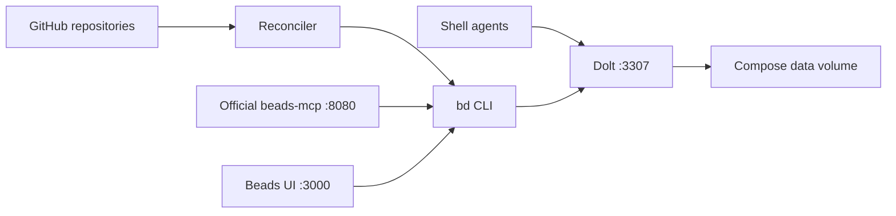

# beads-hub

A shared [Beads](https://github.com/gastownhall/beads) backlog for GitHub issues and pull requests across repositories. Categorize, prioritize, and claim either kind of work using the `bd` CLI, the official beads-mcp server, or [Beads UI](https://github.com/mantoni/beads-ui).

GitHub supplies source text, labels, PR signals, and closure. Beads holds local categories, priorities, assignees, notes, and workflow decisions. Reconciliation reads GitHub; local edits never write back to GitHub.



Issues and PRs are peer tasks with `type:issue` / `type:pr` labels. Actionable PRs enter the open queue. GitHub closing references create dependencies so an open PR blocks its issue until the PR closes. Local labels such as `category:bug-fix` remain yours to manage.

```sh
task install
task lint
task check
task test
task smoke  # Builds the image; tests a disposable stack without GitHub credentials
```

Inject `GH_TOKEN` and `BEADS_REMOTE_PASSWORD` into your shell environment, set `GH_SYNC_QUERY` for your repositories, then run `task deploy` (or `docker compose up -d --build --wait`). Docker Compose starts Dolt, UI, official MCP, and sync with a shared persistent volume. UI (`3000`), MCP (`8080`), and SQL (`3307`) are available on localhost. See [Usage](docs/usage.md) for setup and operating commands.

- [Usage and deployment](docs/usage.md)
- [Agent connections](AGENTS.md)
- [Architecture and sync contracts](docs/architecture.md)
- [Design decisions](docs/decisions.md)
- [Roadmap](docs/roadmap.md) and [validation checklist](docs/checklist.md)

This is a fresh design on the orphan `beads-hub` branch. It does not migrate the earlier gh-maintainer SQLite application. The previous implementation remains on its original branch.
