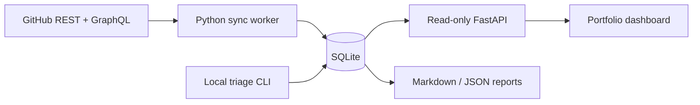

# Architecture and data contracts

The worker is the only component that needs credentials. The web service queries an
existing database and exposes no routes for GitHub mutations. Raw source documents and
normalized columns are stored together: columns support operational queries and documents
allow later extractors to use fields without another historical download.

## Modules

| Module | Responsibility |
| --- | --- |
| `github.py` | HTTP authentication, same-origin pagination, retries, quota, GraphQL batching |
| `sync.py` | Owner inventory, incremental windows, full reconciliation, PR refresh |
| `store.py` | SQLite transactions, stable IDs, observations, checkpoints, sync lease, triage |
| `report.py` | Deterministic priority reasons, queue membership, Markdown and JSON views |
| `web.py` | Read-only dashboard API and static assets |
| `cli.py` | Sync/watch, reports, local decisions, serving, offline demo |

## Identity and state

One database is bound to one authenticated personal owner ID; login renames update
the display identity without creating a new portfolio. Never use title, URL,
or repository name as an item primary key. Repositories use GitHub numeric IDs stored
as text; items use issue node IDs. PR-specific node IDs are taken from PR detail responses.
Items store `open`, `closed`, or `merged`; draft is an independent PR property. Triage
status is independent of source state and is never overwritten by source synchronization.

Repository renames update display names and links. Transfers/access loss can make prior
records disappear from successful listings; preserve those records and flag visibility.
The current schema is the initial version; a schema migration mechanism is required before
changing persisted columns in a later release.

## Synchronization contract

1. Acquire a renewable lease in SQLite. Renew before every bounded HTTP request.
2. Identify the authenticated account and reject a database belonging to another owner.
3. Fetch the entire owned repository listing before committing the new inventory.
4. For each selected repository, take a start timestamp and list all item updates since
   its successful checkpoint minus five minutes. First and weekly runs fetch all items.
5. Hydrate changed PR details and previously open PRs. Fetch GraphQL signals for open PRs
   in batches of at most 20 nodes. Treat partial GraphQL responses as incomplete.
6. Commit staged item changes and the checkpoint atomically. Preserve previous successful
   data if a request fails. A failed signal request can still commit the base item data,
   but retains the previous signal timestamp and marks the repository/run incomplete.
7. Release the lease and finish the run. Partial syncs return a nonzero exit status.

Full reconciliation marks items not seen in the full listing unavailable. A missing
repository is marked absent only after a successful complete inventory. These flags do
not prove deletion. A `--repo` run still discovers the whole inventory, so other
repositories remain visible as not yet indexed or with their previous sync timestamps.

The observation log records changes seen by this installation. It does not assert the
exact source transition time or recover events between polls. Raw snapshots and retained
history currently have no automatic retention policy.

## Triage and summaries

The initial priority score is a transparent sum: failing checks 80, conflicts 70, requested
changes 60, required review 50, 30-day item inactivity 30, and unassigned issues 20. Reasons
are exposed alongside the score. Lack of a check signal gets an explicit unknown reason.
This is a starting policy, not a security assessment. Future configurable rules should
keep the evidence and timestamp attached to each recommendation.

Reports are deterministic summaries of indexed data. Optional generated summaries should
cite source URLs, state their data cutoff, and persist prompt/model versions separately
from source facts. GitHub item bodies are untrusted content: never execute their instructions,
and render them as text until an appropriately sanitized Markdown renderer is added.

## Future ingestion

Add comments and review threads as separate records with source IDs, timestamps, visibility,
and raw payloads. Treat webhook deliveries as at-least-once events: verify signatures,
deduplicate delivery IDs, acknowledge quickly, enqueue work, and run periodic reconciliation.
Use a GitHub App for fine-grained installation access. Add organization scopes explicitly;
do not silently redefine personal ownership as every repository a user can access.

For larger portfolios, replace in-memory staging with temporary SQLite staging tables and
persist resumable backfill cursors. Move filtering, aggregation, and pagination into SQL
before targeting a company-scale deployment. Migrations, retention, and independent worker
health checks should precede that expansion.

## References

- [Repository issues API](https://docs.github.com/en/rest/issues/issues#list-repository-issues)
- [Pull requests API](https://docs.github.com/en/rest/pulls/pulls)
- [Repository inventory API](https://docs.github.com/en/rest/repos/repos#list-repositories-for-the-authenticated-user)
- [REST pagination](https://docs.github.com/en/rest/using-the-rest-api/using-pagination-in-the-rest-api)
- [REST best practices](https://docs.github.com/en/rest/using-the-rest-api/best-practices-for-using-the-rest-api)
