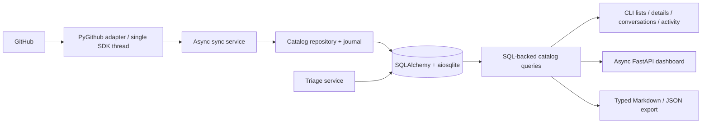

# Architecture and data contracts

This page describes the current implementation. The [scope and roadmap](roadmap.md)
defines the intended CLI baseline, remaining ingestion and analysis work, and the later
focus on agent skills.

## Boundaries

| Module              | Responsibility                                                                                   |
| ------------------- | ------------------------------------------------------------------------------------------------ |
| `schemas.py`        | Validated source snapshots, state/disposition enums, explicit API/export contracts               |
| `models.py`         | Typed SQLAlchemy records, JSON payloads, aware UTC timestamps                                    |
| `database.py`       | Engine/session lifecycle, SQLite pragmas, serialized Alembic upgrades                            |
| `migrations/`       | Packaged, versioned schema changes and legacy adoption                                           |
| `github.py`         | Source protocol and PyGithub adapter; SDK owns transport, retries, authentication and pagination |
| `sync.py`           | Discovery, backfill windows, reconciliation, PR refresh and error policy                         |
| `repositories.py`   | Catalog writes, fenced sync lease, run journal, local analysis and processing decisions          |
| `queries.py`        | SQL filtering, totals, queue ranking, pagination and targeted detail loading                     |
| `policies.py`       | Pure priority and queue rules over typed snapshots                                               |
| `report.py`         | Markdown rendering over a typed portfolio; no SQL or SDK access                                  |
| `web.py` / `cli.py` | Thin presentation and command entry points                                                       |
| `clock.py`          | Shared timezone-aware clock and conversion helpers                                               |

Pydantic validates data at the source boundary. Application code receives typed snapshots;
ORM objects remain within persistence/query modules. JSON columns retain source documents
without manual JSON string encoding across services. State and triage disposition are
separate enums. Item and repository URLs and names are display attributes, not identities.

One database can contain repositories from multiple user and organization owners. `owners`
stores stable account IDs and display logins; `repo_owners` records current repository
membership. Successful complete inventories reconcile presence only within that owner's
scope. Public-only inventories reconcile only known-public records; explicit lists only
upsert their resolved repositories. Login changes and repository transfers retain IDs,
source records, and local decisions. PR-specific node IDs come from PR details for GraphQL
enrichment. Legacy owner metadata remains stored for compatibility.

## Async lifecycle and transactions

The application owns one async engine/session factory, with a fresh `AsyncSession` per
operation or request. Sessions are never shared across concurrent tasks. API startup and
CLI initialization run Alembic once per engine; request handlers do not initialize schemas.

PyGithub is synchronous. Every SDK operation, including lazy pagination and payload
extraction, runs on one dedicated executor thread. Network calls never hold a database
transaction. A narrowly scoped adapter uses the SDK's base raw-payload accessor to avoid
hydrating every listed issue/repository with another request. Adapter tests verify that
1,001 issues require 11 listing requests and that SDK work leaves the event loop responsive.

GitHub batches are staged as validated snapshots. The catalog commits one repository's
items, comments, observations, availability and checkpoints in one short transaction. A failed page
or detail fetch leaves that repository's checkpoint unchanged. Failed GraphQL enrichment
can commit usable item data while retaining the original signal timestamp and marking
coverage incomplete. Effective signals become unknown when their head or repository
freshness is invalid.

Issue/inline comment feeds use their own overlapped checkpoint. Review bodies are listed
for every known available PR on each sync, including closed and merged PRs; their endpoint
has no incremental filter. Full reconciliation retains missing comments as unavailable.
Raw comment payloads preserve reply IDs and line context. Failed conversation fetches do
not advance either repository checkpoint. GraphQL thread resolution is outside this index.

The SQLite lease uses an atomic conditional upsert, a heartbeat in an independent session,
and a token check inside catalog write transactions. An expired worker cannot overwrite a
new worker's results. Interrupted run records are marked on the next successful lease
acquisition. Request sessions can read while the worker fetches GitHub data. SQLite remains
a single-writer database; aiosqlite provides event-loop integration, not parallel writers.

## Querying and triage

The item endpoint executes a count and a SELECT with SQL filtering, ordering, LIMIT and
OFFSET. Overview counts are SQL aggregates; item details only load the requested item and
its latest observations. Full JSON/Markdown exports intentionally read the whole portfolio.

The pure policy adds explicit reasons and scores: failing checks 80, conflicts 70, changes
requested 60, required review 50, 30-day inactivity 30, and unassigned issues 20. Missing
checks are unknown. SQL expressions implement the same rules for ranking/filtering; parity
tests compare SQL results with pure policy evaluations.

Local triage notes survive synchronization. A snooze requires a future aware timestamp and
expires in both SQL and presentation rules. An item marked locally done returns to the
inbox when its source update time advances. GitHub state is never changed by local triage.

Each item also has a monotonic source revision. Meaningful item/signal changes and comment
changes increment it once per sync; freshness-only polling does not. Observations retain
their event kind, revision, and before/after snapshots. A local done decision records its
source revision and returns to the inbox on later source activity, including a push or
comment edit without a parent timestamp change. Legacy triage keeps its timestamp fallback.

`summaries`, `classifications`, and `rankings` each store one current caller-supplied result
per item with producer, reason, source revision, and save time. Stale results remain visible
in item details; stale ranks and classifications do not drive current ranking/filtering.
Fixed caller-supplied scores have no implicit time decay. Pure priority rules still evaluate
elapsed time on each query. `processing` stores a shared per-item acknowledged revision,
actor, and time. Reads and analysis writes do not advance it. Optional revision guards reject
stale writes; marking processed requires complete repository coverage.

The CLI reuses the SQL query layer for lists, details, comments, and activity history.
Processing, triage, and classification filters and rank sorting execute in SQLite with
deterministic pagination. All local query and maintenance commands work without credentials.

## Migration contract

The baseline recognizes the original six-table schema, checks every column name, and
adopts it without copying or rewriting records. Unknown or partially matching schemas are
rejected transactionally. New databases are created with the versioned baseline. Both
paths are tested, including concurrent startup, idempotent upgrades and exact preservation
of every legacy table value.

Migration `0002` adds `owners` and `repo_owners` and backfills membership from raw repository
ownership or the legacy owner metadata. Existing tables and their values are preserved.

Migration `0003` adds conversations, analysis, processing, source revisions, and comment
checkpoints. Added columns preserve original values and legacy observations; old activity
has no inferred revision. Original notes, source documents, and checkpoints are retained.

SQLite permits legacy TEXT JSON, integer booleans, and primary-key declarations that do
not explicitly repeat NOT NULL. Alembic comparison hooks recognize those existing storage
declarations without proposing unrelated table rebuilds. Changed/missing keys and changed
key types remain visible to autogeneration. Review each future migration before applying it.

Migration files and the generation template ship inside the wheel and container. Use
`gh-maintainer migrate` to upgrade, or `alembic revision --autogenerate` and `alembic check`
from the source checkout. The `--db` option and `GH_MAINTAINER_DB` retain the index selection
behavior. Sync telemetry is now explicitly named `source_calls` because SDK operations
can perform multiple HTTP requests; old counts remain stored in the original column.

## Retained limitations

Coverage is limited to repositories visible to the credential. This is a polling index;
observations do not reconstruct transitions between polls or events before the first sync.
Other users' named inventories use GitHub's public listing; explicit repository lists
can index accessible private repositories across owners. Webhooks, releases and security
findings are later extensions. Initial staging is
still per repository; resumable disk-backed staging should precede very large backfills.
Stored observations currently have no automatic retention policy. GitHub bodies remain
untrusted and are rendered as plain text.

## References

- [SQLAlchemy async sessions](https://docs.sqlalchemy.org/en/20/orm/extensions/asyncio.html)
- [SQLite async dialect](https://docs.sqlalchemy.org/en/20/dialects/sqlite.html#module-sqlalchemy.dialects.sqlite.aiosqlite)
- [Alembic asyncio migrations](https://alembic.sqlalchemy.org/en/latest/cookbook.html#using-asyncio-with-alembic)
- [PyGithub utilities](https://pygithub.readthedocs.io/en/stable/utilities.html)
